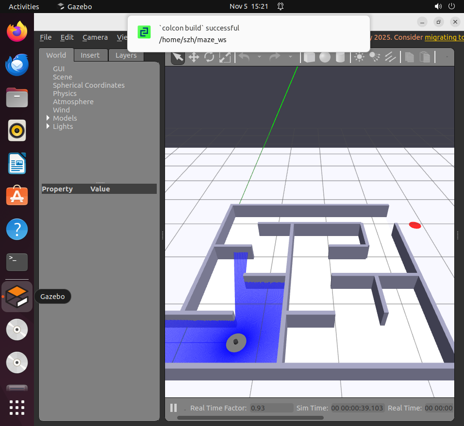
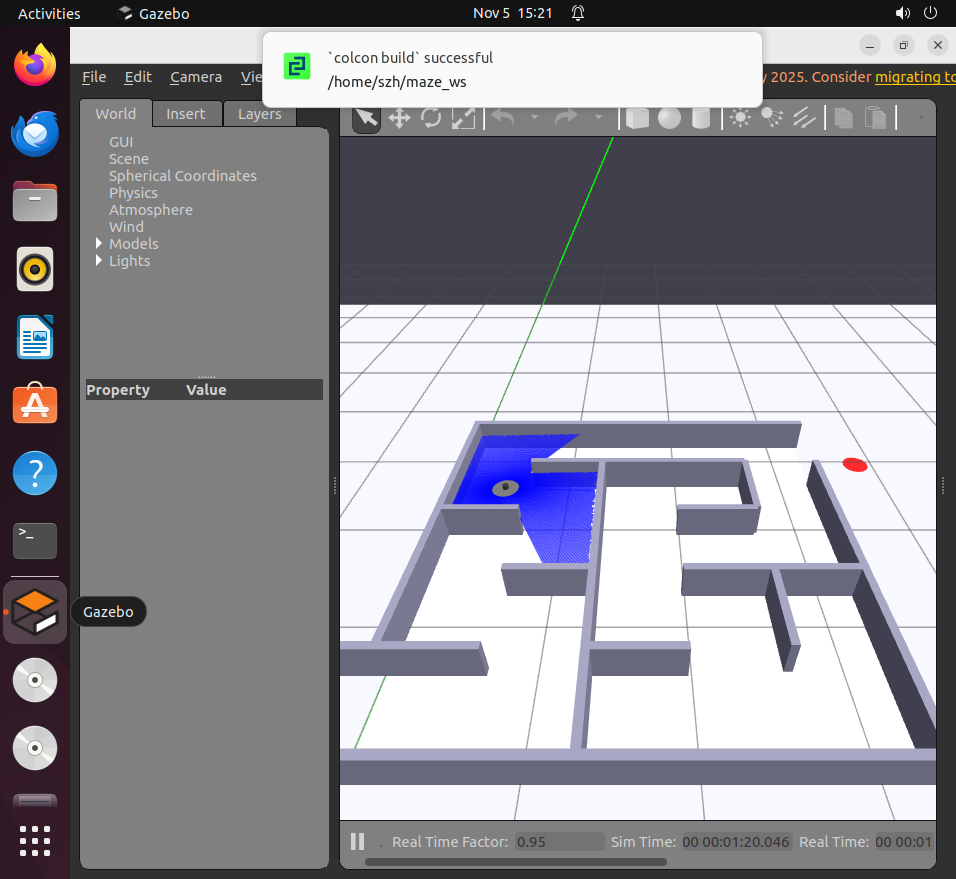
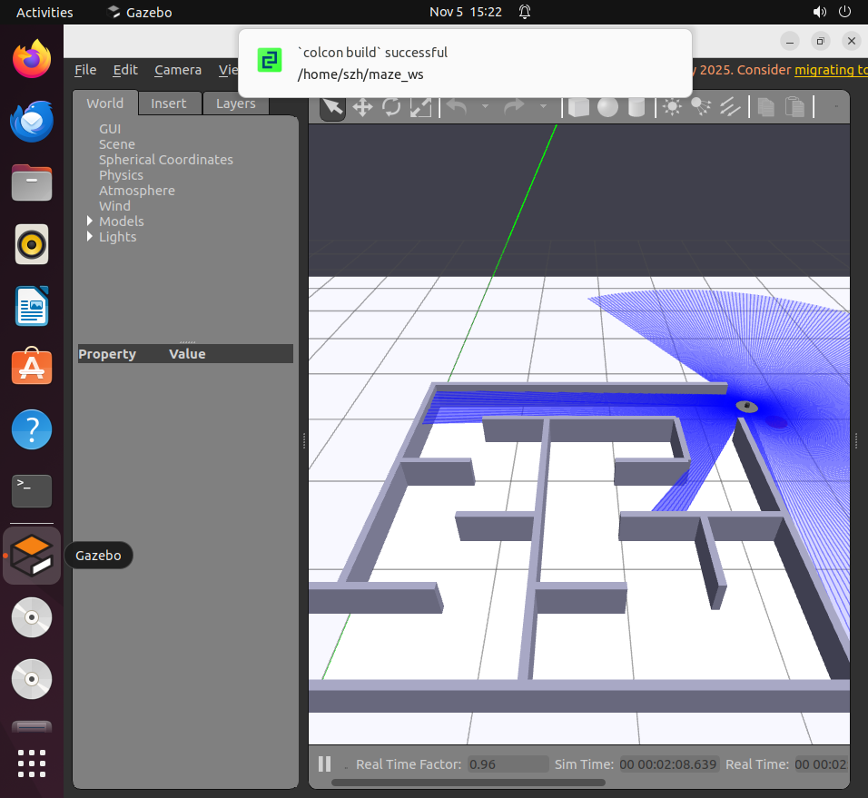
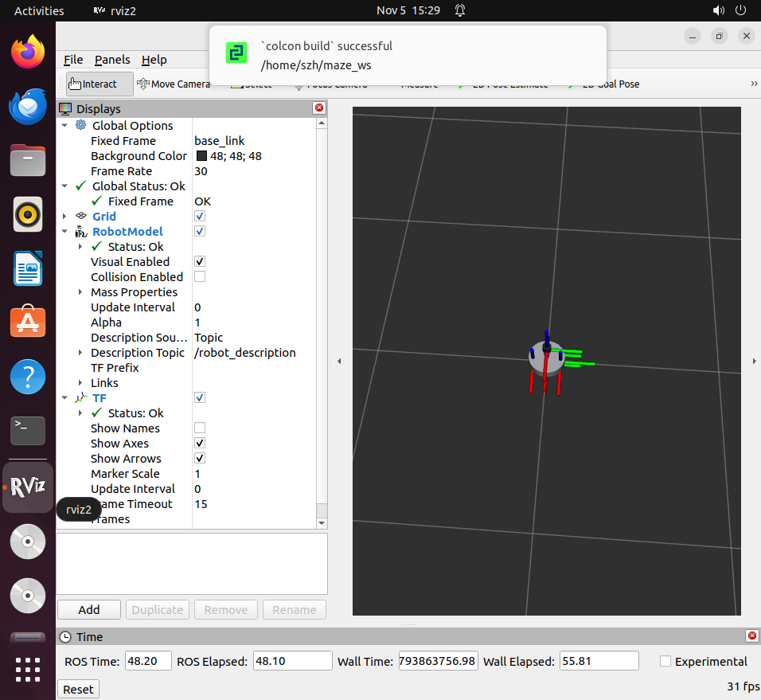

# MicroMouse 走迷宫系统 · ROS2 Humble + Gazebo

> 基于 ROS2 Humble 与 Gazebo Classic 11 的**地老鼠（MicroMouse）走迷宫**仿真项目：自建 URDF 模型、自定义矩形墙体迷宫、Python launch 一键启动，仅用 **2D 激光雷达 + 轮式里程计** 实现**左手法则（Left-Hand Rule）**迷宫求解。

**课程代码：(2026-2027-1)-S0610350-04**

作者：SHI ZHENGHAO、ZHANG JIE

---

## 演示效果

| 迷宫全景（含激光扫描线） | 运行途中 |
| --- | --- |
|  |  |

| 到达出口 | RViz2 中的机器人模型 |
| --- | --- |
|  |  |

---

## 功能特性

- **自建 URDF 模型**：6 link / 5 joint 的差速小车（TurtleBot3-Burger 尺寸），含差速驱动、关节状态、激光雷达三个 Gazebo 插件
- **自定义迷宫世界**：5×5 格、格距 0.66 m，用脚本按 DFS 生成**无环完美迷宫**（生成树），自动做连通性与无环自检
- **一键启动**：一条 `ros2 launch` 拉起 Gazebo 世界、机器人模型、RViz 与算法节点，`mission:=` 参数切换实验
- **模块化算法**：纯 Python 算法核心（不依赖 ROS），可离线单测；ROS 节点只负责收发话题
- **四个递进实验**：开环控制 → 里程计 P 控制 → 雷达分区与反应式避障 → 左墙跟随走迷宫
- **实测数据完整**：从环境自检、编译、话题频率到全程运行的日志与截图都在 `docs/` 下

---

## 运行环境

| 项目 | 版本 |
| --- | --- |
| 操作系统 | Ubuntu 22.04 LTS（虚拟机需开启 3D 加速） |
| ROS2 | Humble |
| 仿真器 | Gazebo Classic 11（`ros-humble-gazebo-ros-pkgs`） |
| Python | 3.10 |
| 编译工具 | colcon（`python3-colcon-common-extensions`） |

依赖安装：

```bash
sudo apt update
sudo apt install -y ros-humble-desktop \
                    ros-humble-gazebo-ros-pkgs \
                    ros-humble-gazebo-plugins \
                    ros-humble-robot-state-publisher \
                    ros-humble-xacro ros-humble-tf2-tools \
                    python3-colcon-common-extensions
```

> 国内网络若访问 `raw.githubusercontent.com` 失败，可用清华镜像取密钥：
> ```bash
> sudo curl -sSL https://mirrors.tuna.tsinghua.edu.cn/rosdistro/ros.key \
>   -o /usr/share/keyrings/ros-archive-keyring.gpg
> ```

---

## 快速开始

```bash
# 1. 编译
mkdir -p ~/maze_ws/src
cp -r src/maze_mouse ~/maze_ws/src/
cd ~/maze_ws
colcon build --symlink-install
source install/setup.bash

# 2. 一键启动（Gazebo + 机器人 + RViz）
ros2 launch maze_mouse maze_bringup.launch.py
```

启动成功的标志：Gazebo 里出现 5×5 迷宫、车停在左下角带三面墙的出发区；终端打印
`Successfully spawned entity [maze_mouse]`；`ros2 topic list` 中有 `/scan`、`/odom`、`/joint_states`。

### 跑四个实验

```bash
# ① 开环控制：直行 2 s / 原地转 90°
ros2 run maze_mouse open_loop_drive --ros-args -p mode:=forward -p value:=0.15 -p duration:=2.0
ros2 run maze_mouse open_loop_drive --ros-args -p mode:=turn -p value:=0.5 -p duration:=3.1416

# ② 里程计 P 控制点到点（建议先在空旷世界做）
ros2 run maze_mouse p2p_control --ros-args -p goal_x:=1.0 -p goal_y:=2.0

# ③ 雷达分区与反应式避障（空旷世界）
ros2 run maze_mouse scan_zones
ros2 run maze_mouse reactive_avoid

# ④ 左墙跟随走迷宫
ros2 run maze_mouse wall_follower
# 或随仿真一起启动
ros2 launch maze_mouse maze_bringup.launch.py mission:=wall_follower
```

空旷世界（做 P 控制与避障用）：

```bash
ros2 launch maze_mouse maze_bringup.launch.py \
  world:=$HOME/maze_ws/src/maze_mouse/world/empty.world mission:=avoid
```

### 重新生成迷宫

```bash
ros2 run maze_mouse gen_maze_world --out /tmp/maze.world --check   # 只自检
ros2 run maze_mouse gen_maze_world --out src/maze_mouse/world/maze.world \
                                   --json /tmp/maze_layout.json
```

---

## 项目结构

```
.
├── README.md
├── LICENSE
├── docs/
│   ├── images/            运行截图与验证截图
│   ├── logs/              实测日志（左墙跟随全程、分区读数等）
│   └── ARCHITECTURE.md    系统设计与算法说明
└── src/
    └── maze_mouse/
        ├── package.xml / setup.py / setup.cfg
        ├── urdf/maze_mouse.urdf        机器人模型（6 link / 5 joint）
        ├── world/maze.world            5×5 迷宫（脚本生成）
        ├── world/empty.world           空旷场景 + 障碍柱
        ├── launch/maze_bringup.launch.py   一键启动
        ├── tools/validate_maze.py      离线几何校验（numpy 射线求交，3 秒跑完全程）
        └── maze_mouse/
            ├── maze_mouse_core.py      纯算法核心（不依赖 ROS）
            ├── wall_follower.py        左墙跟随主控
            ├── traj_plot.py            实时轨迹可视化（/odom 逐点累积）
            ├── scan_zones.py           雷达分区
            ├── reactive_avoid.py       反应式避障
            ├── p2p_control.py          点到点 P 控制
            ├── waypoint_follower.py    航点跟踪
            ├── open_loop_drive.py      开环控制
            └── gen_maze_world.py       迷宫生成器
```

---

## 算法说明

三层结构：**感知（把 360 点压成三个距离）→ 决策（左手法则状态机，按格决策）→ 控制（角闭环 + 航向保持）**。

### 为什么按"格"决策而不是连续反应式

走廊只有 0.60 m 宽。若用连续 PD `ω = Kp(left − d_des)`，车一过路口，"左方最近点"会变成**身后墙面的拐角**（实测 left 从 0.30 跳到 0.43 再到 0.90），控制律跟着抖，车在路口摇摆。

因此本项目采用 MicroMouse 的经典做法：**每走到格心停一下 → 读三面墙 → 按左手法则定方向 → 用里程计精确转 90° → 再走一格**。每个决策点的几何都干净，轨迹可复现。

### 扇区宽度为什么只取 ±12°

前方扇区的边缘射线会斜着打到侧墙，距离为 `0.30 / sin α`：

| 扇区半宽 | 侧墙被误算成"前方距离" | 结果 |
| --- | --- | --- |
| 35° | 0.52 m | 直道上 front 恒为 0.52，状态机误判"前方有墙" |
| 12°（本项目） | 1.44 m | 读数干净 |

### 状态机

```
DECIDE（格心读三面墙） → TURN（里程计角闭环转 90°/180°） → ADVANCE（直行一格） → DECIDE …
                                                  越过出口门限 → ARRIVED（停车）
```

决策优先级：**左开 > 前通 > 右开 > 掉头**，阈值 `wall_thresh = 0.55 m`

（格心到本格边界墙 0.33 m、到下一格远处的墙 ≥0.96 m，0.55 正好在中间，两侧各留 0.2 m 余量）。

更详细的设计说明见 [docs/ARCHITECTURE.md](docs/ARCHITECTURE.md)。

---

## 实验结果（实测）

| 指标 | 结果 |
| --- | --- |
| 迷宫 | 5×5 格，格距 0.66 m，最短路径 13 步 |
| 左墙跟随全程 | **14 次决策、约 84 s**，两次独立运行均成功 |
| 到达位置 | `odom.x = 3.76`（出口门限 3.75），即驶出洞口约 13 cm |
| P 控制点到点误差 | **39.2 mm**，航向误差 −0.1° |
| 开环直行 | 指令 0.300 m，实测 0.282 m（**−6.0 %**） |
| 开环转向 | 指令 90°，实测 80.9°（**−9.1°**） |
| 雷达分区（出发点） | 前 1.48 / 左 0.27 / 右 0.28 / 后 0.28 m |
| 话题频率 | `/scan` 9.4 Hz、`/odom` 47 Hz |

原始日志见 `docs/logs/`，截图见 `docs/images/`。

---

## 踩过的坑（排错记录）

| 现象 | 原因 | 解决 |
| --- | --- | --- |
| `spawn_entity.py` 崩溃、Gazebo 里没车、话题全无，但 RViz 能显示模型 | URDF 首行带 `encoding="utf-8"`，`spawn_entity` 把文件读成字符串交给 lxml，lxml 拒绝"Unicode 字符串 + 编码声明" | 删掉该属性，首行只留 `<?xml version="1.0"?>` |
| 里程计读数等于世界坐标，格心全部错位 | diff_drive 插件默认用世界位姿作里程计源 | `<odometry_source>0</odometry_source>`（编码器积分） |
| 车头持续下栽，俯仰 18.5°，雷达前向读数从 1.62 m 掉到 0.50 m | 质心正好落在轮轴上，投影位于"两轮 + 万向球"支撑三角形边界 | `base_link` 的 `<inertial><origin>` 沿 x 后移 0.02 m |
| 不发指令车以 12 cm/s 匀速往后爬 | 地面用默认接触刚度 `kp=1e12`，与 1 ms 步长叠加产生接触抖动 | world 加 `<surface>`：`kp=1e6, kd=100`，轮子 `kd` 与之统一 → 漂移降到 0.36 mm/s |
| `No transform from [wheel_left_link]` | `/joint_states` 未发布（spawn 失败导致插件未加载） | 修好 spawn 后自动消失 |
| `ros2 topic list` 里没有 `/scan` | 雷达插件缺 remapping | `<remapping>~/out:=scan</remapping>` |

---

## 已知限制

- 左手法则只在**连通且无环**的迷宫中保证可达；含环迷宫会绕圈
- **速度不连续**："停—转—走"使单程时间偏长（84 s）
- 转弯滑移带来 1～2° 转角误差，依赖侧墙居中修正兜底

后续计划（拓展任务）：Pure-Pursuit 轨迹跟踪、速度自适应、洪水填充/栅格建图。

---

## 许可证

本项目采用 [MIT License](LICENSE)。

## 致谢

- [ROS 2 Humble 文档](https://docs.ros.org/en/humble/)
- [Gazebo Classic 文档](https://classic.gazebosim.org/)
- 机器人尺寸参数参考 TurtleBot3-Burger 规格

> 本项目为课程作业。SLAM 建图、全局导航、深度学习不在本任务范围内。
